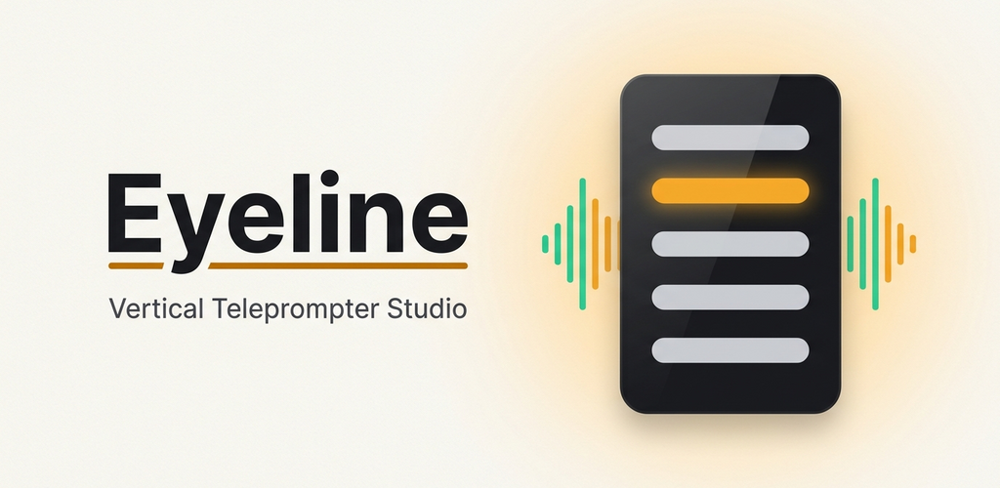
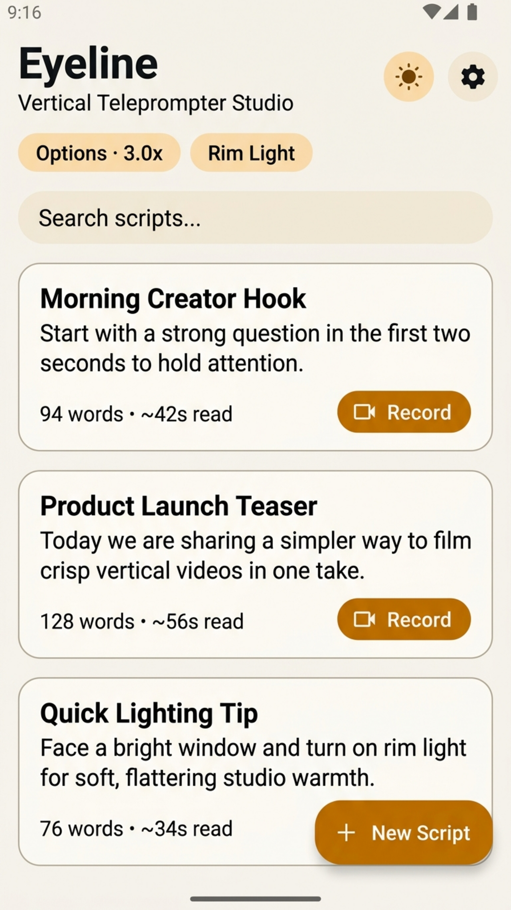
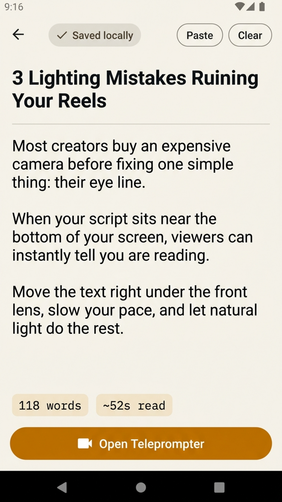
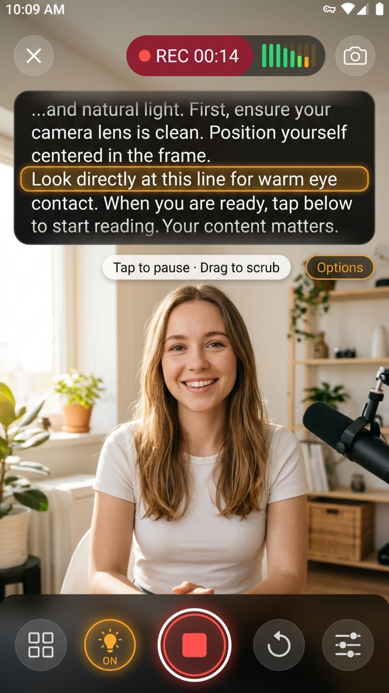
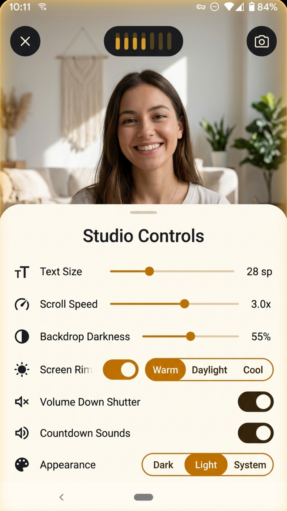
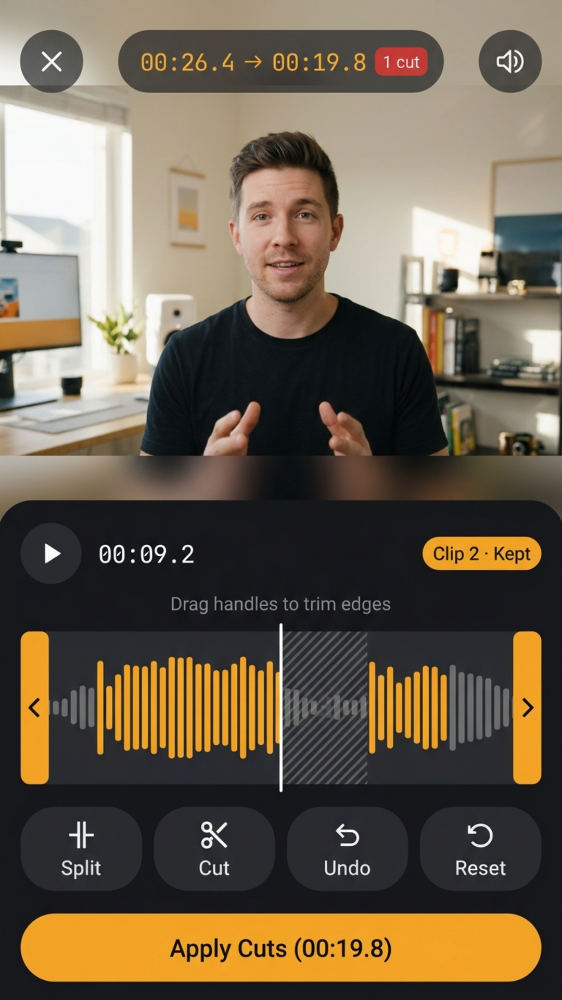

<div align="center">



# Eyeline

**Minimalist vertical teleprompter, studio camera, and waveform video cutter for Android.**

[-34D399?style=flat-square&logo=android&logoColor=white)](https://developer.android.com)
[](https://kotlinlang.org)
[](https://developer.android.com/jetpack/compose)
[](https://developer.android.com/media/media3)
[](LICENSE)

Film crisp Reels, Shorts, and TikToks in a single take with natural eye contact—then trim edges, cut stumbles on an audio waveform timeline, and export straight to your gallery with script title and date metadata embedded. **100% on-device. No accounts, no watermarks, no subscriptions.**

</div>

---

## Screenshots

<table>
  <tr>
    <td align="center" width="20%">
      <br />
      <sub><b>Script Library</b></sub>
    </td>
    <td align="center" width="20%">
      <br />
      <sub><b>Script Editor</b></sub>
    </td>
    <td align="center" width="20%">
      <br />
      <sub><b>Teleprompter Studio</b></sub>
    </td>
    <td align="center" width="20%">
      <br />
      <sub><b>Controls &amp; Rim Light</b></sub>
    </td>
    <td align="center" width="20%">
      <br />
      <sub><b>Waveform Trim &amp; Cut</b></sub>
    </td>
  </tr>
</table>

---

## Key Features

### Lens-Aligned Teleprompter & Camera Studio
- **Natural Eye-Line Placement**: Positions your scrolling script directly beneath the front camera lens with a warm-amber reading guide, soft top/bottom alpha fade, and a brief opening lead-in hold so you never miss your first line.
- **One-Handed Controls**: Tap anywhere to pause or resume scrolling, drag vertically to scrub your place in the script, or press the hardware **Volume Down** button to start and stop recording hands-free.
- **3-2-1 Studio Countdown & Audio Cues**: Non-obstructing visual countdown paired with crisp synthesized studio tones (`3`, `2`, `1`) so you always know the exact moment recording begins.
- **Live Audio Level Meter**: Real-time 7-bar microphone level indicator centered at the top of the viewfinder—active both before and during recording—so you never film a silent take.
- **Built-In Screen Rim Light**: Turns the outer screen edges into a soft face fill light with selectable **Warm**, **Daylight**, and **Cool** tones, adjustable intensity, and automatic brightness boost (available in both Dark and Light modes).
- **Sticky Studio Preferences**: Your preferred scroll speed, text size, backdrop darkness, framing grid, rim light settings, and appearance mode (**Dark**, **Light**, or **System**) persist automatically.

### Post-Recording Waveform Trim & Cut Editor
- **On-Device Audio Waveform**: Decodes your recorded take's audio track into vertical loudness bars so pauses, breath gaps, and verbal stumbles stand out visually.
- **Trim Start/End & Cut Middle Sections**: Drag Warm Amber edge brackets to tighten openings and endings, or scrub the playhead, tap **Split**, and toggle **Cut / Restore** on any middle segment—with full **Undo** and **Reset** support.
- **Live Cut-Skipping Preview**: Preview how tight your jump-cuts feel in real time before rendering.
- **Fast On-Device Rendering**: Stitches kept segments into a clean MP4 using hardware-accelerated **Jetpack Media3 Transformer** while keeping your original take non-destructive until you retake or leave the studio.

### Script Library & Metadata-Tagged Gallery Export
- **Offline Script Desk**: Create, search, duplicate, paste, and auto-save multiple scripts locally with live word counts and speed-calibrated read-time estimates.
- **Rich Gallery Metadata**: Exporting via **Save Video** writes directly to `Movies/Eyeline` using Android Scoped Storage (`MediaStore`), embedding the **script title** and **recording date/time** into both the file name and media metadata.

---

## Tech Stack & Architecture

Eyeline is built in pure **Kotlin** using modern Android architecture (**MVVM** with unidirectional `StateFlow` UI state):

| Layer | Technology |
| :--- | :--- |
| **UI & Design System** | Jetpack Compose, Material Design 3 (Deep Charcoal & Warm Amber Dark Mode / Warm Ivory & Burnished Amber Light Mode), bundled Space Grotesk, Plus Jakarta Sans & JetBrains Mono fonts |
| **Navigation** | Navigation Compose with type-safe `@Serializable` routes |
| **Camera & Audio Capture** | CameraX `1.5.0` (`Preview`, `VideoCapture`, `Recorder`, `AudioStats`), `AudioRecord` pre-roll monitor, `AudioTrack` countdown synthesizer |
| **Playback & Video Editing** | Jetpack Media3 `1.5.1` (`ExoPlayer`, `PlayerView`, `Transformer`, `Composition`), Android `MediaExtractor` + `MediaCodec` RMS waveform decoder |
| **Local Persistence** | Room + KSP (script library), Jetpack DataStore Preferences (studio settings) |
| **Media Export** | Android Scoped Storage (`MediaStore.Video`) — zero broad storage permissions required |

### Core Modules Overview

```text
app/src/main/java/com/example/
├── MainActivity.kt                  # Edge-to-edge host, dynamic system bars, Volume Down shutter hook
├── capture/
│   ├── TimelineEditModel.kt         # Pure, non-destructive cut-list & live skip-over playback engine
│   ├── AudioWaveformExtractor.kt    # On-device PCM RMS waveform analyzer (MediaExtractor + MediaCodec)
│   ├── VideoCutRenderer.kt          # Media3 Transformer segment clipping & concatenation
│   ├── VideoGalleryExporter.kt      # Scoped Storage MP4 exporter with script title & date metadata
│   ├── PreRollAudioMonitor.kt       # Live pre-recording microphone level sampler
│   ├── CountdownSoundPlayer.kt      # Low-latency 3-2-1 studio cue synthesizer
│   └── HardwareShutterBus.kt        # Scoped Volume Down shutter event bus
├── data/
│   ├── local/                       # Room database, ScriptEntity, ScriptDao
│   ├── model/                       # Word count & speed-calibrated read-time calculator
│   ├── preferences/                 # Write-through DataStore Preferences repository
│   └── repository/                  # ScriptsRepository with starter script seeding
└── ui/
    ├── navigation/                  # Type-safe @Serializable routes
    ├── theme/                       # Material 3 Dark/Light palettes, typography, shapes
    ├── viewmodel/                   # ScriptsViewModel, StudioViewModel (Capture/Review/Trimming FSM)
    ├── components/                  # TeleprompterOverlay, WaveformTimeline, StudioOverlays, QuickAdjustDrawer
    └── screens/                     # ScriptLibraryScreen, ScriptEditorScreen, TeleprompterStudioScreen,
                                     # TakeReviewScreen, TakeTrimEditorScreen
```

---

## Getting Started

### Prerequisites
- **Android Studio** Ladybug (or newer)
- **JDK 11** or higher
- **Android SDK 36** (`minSdk = 24`, `targetSdk = 36`)
- An Android device or emulator with front camera & microphone support

### Build & Run
1. Clone this repository:
   ```bash
   git clone https://github.com/<your-username>/<your-repo-name>.git
   cd <your-repo-name>
   ```
2. Open the project in **Android Studio** and allow Gradle to sync dependencies.
3. Select a connected Android device (recommended for real camera & microphone testing) and click **Run**, or build from the command line:
   ```bash
   ./gradlew :app:assembleDebug
   ```
4. Run unit tests:
   ```bash
   ./gradlew :app:testDebugUnitTest
   ```

> **No API keys or backend configuration required.** Eyeline runs completely offline on-device out of the box.

---

## Permissions & Privacy

Eyeline follows strict least-privilege Android permissions:

| Permission | Purpose |
| :--- | :--- |
| `CAMERA` | Live camera preview and vertical video recording inside Teleprompter Studio |
| `RECORD_AUDIO` | Capturing spoken audio during recording and driving the live microphone level meter |

- **No broad storage permissions**: Videos are exported using Android's Scoped Storage `MediaStore` API—Eyeline never requests `READ_EXTERNAL_STORAGE` or `READ_MEDIA_VIDEO`.
- **On-device only**: Scripts, preferences, and temporary takes stay strictly on your device. No analytics, tracking SDKs, or cloud uploads.

---

## Contributing

Contributions, bug reports, and feature ideas are welcome! Please read [CONTRIBUTING.md](CONTRIBUTING.md) before opening a pull request.

## License

This project is licensed under the **MIT License** — see the [LICENSE](LICENSE) file for details.
